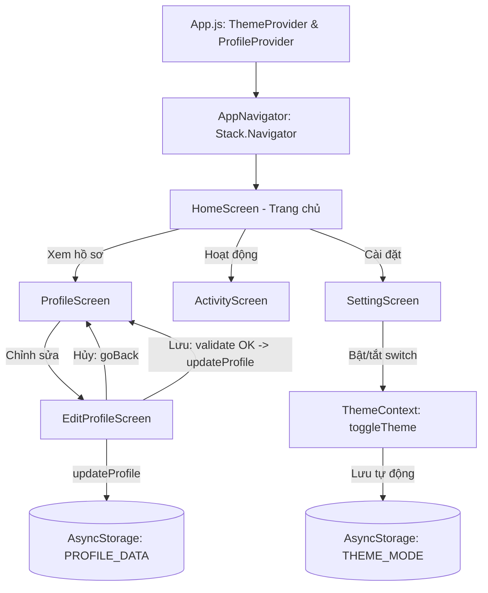

# MMA301 Assignment 1 — Profile & Activity Management App

Ứng dụng di động xây dựng bằng **React Native (Expo)** phục vụ môn học **MMA301 (Mobile Application Development)**. Ứng dụng cung cấp các tính năng quản lý hồ sơ cá nhân (Profile), danh sách hoạt động thường ngày (Activity) và tùy chỉnh giao diện sáng/tối (Dark/Light Theme) với cơ chế lưu trữ dữ liệu bền vững (AsyncStorage).

---

## 1. Overview (Tổng quan)

### 1.1 Mục tiêu dự án
- Xây dựng ứng dụng di động đa màn hình hoàn chỉnh, tuân thủ kiến trúc phân tầng sạch sẽ (**Clean Architecture / Separation of Concerns**).
- Ứng dụng điều hướng luồng người dùng mượt mà với **React Navigation (Native Stack)**.
- Quản lý trạng thái phân tầng: tách biệt rõ ràng giữa **Local State**, **Form State**, **Global Shared State (Context API)** và **Persistent State (AsyncStorage)**.
- Thiết kế giao diện phản hồi tốt (**Responsive Design**), hỗ trợ **Dark Mode** toàn diện và xử lý an toàn các trạng thái lỗi/dữ liệu rác (Corrupted Data Fallback).

### 1.2 Công nghệ sử dụng
- **Core Framework**: React Native (0.86.3), React 19.2.3, Expo SDK 57 (~57.0.25).
- **Navigation**: `@react-navigation/native` (v7), `@react-navigation/native-stack` (v7).
- **Persistence**: `@react-native-async-storage/async-storage` (2.2.0).
- **Safe Area & UI Support**: `react-native-safe-area-context`, `react-native-screens`.
- **Language**: JavaScript (ES6+).

### 1.3 Cấu trúc thư mục dự án
```text
mma301-assignment1/
├── App.js                     # Root entry point: Bọc ThemeProvider & ProfileProvider, khởi chạy AppNavigator
├── index.js                   # Expo registry entry point
├── package.json               # Cấu hình dự án và dependencies
└── src/
    ├── components/            # Reusable UI components
    │   ├── ActivityItem.js    # Item hiển thị công việc trong FlatList (checkbox + title)
    │   ├── EmptyState.js      # Hiển thị khi danh sách trống
    │   ├── FormField.js       # Input form tái sử dụng, tích hợp nhãn và thông báo lỗi
    │   ├── PrimaryButton.js   # Nút bấm tùy biến (Primary / Secondary variants)
    │   └── ThemeToggle.js     # Switch chuyển đổi Dark/Light mode
    ├── constants/             # Giá trị mặc định và quy tắc nghiệp vụ
    │   ├── defaultProfile.js  # Schema dữ liệu hồ sơ mặc định và Storage Keys
    │   ├── spacing.js         # Quy chuẩn khoảng cách và typography
    │   └── validationRules.js # Logic kiểm tra tính hợp lệ form hồ sơ
    ├── context/               # Quản lý Global State bằng React Context
    │   ├── ProfileContext.js  # Cung cấp profile, updateProfile và trạng thái hydration
    │   └── ThemeContext.js    # Cung cấp bảng màu (colors), isDark và hàm toggleTheme
    ├── navigation/            # Cấu hình điều hướng
    │   └── AppNavigator.js    # Stack Navigator cho toàn bộ 5 màn hình
    ├── screens/               # 5 Màn hình chức năng
    │   ├── HomeScreen.js      # Dashboard chính điều hướng tới các module
    │   ├── ProfileScreen.js   # Hiển thị thông tin hồ sơ người dùng
    │   ├── EditProfileScreen.js # Form chỉnh sửa hồ sơ với validation và Save/Cancel
    │   ├── ActivityScreen.js  # Danh sách hoạt động với FlatList và Empty State
    │   └── SettingScreen.js   # Cài đặt giao diện ứng dụng (Dark Mode)
    ├── storage/               # Tầng tương tác lưu trữ dữ liệu
    │   └── storageHelper.js   # Helper tập trung giao tiếp AsyncStorage với try/catch an toàn
    └── utils/                 # Các hàm tiện ích hỗ trợ
```

---

## 2. Cách chạy ứng dụng (Getting Started)

### 2.1 Yêu cầu môi trường (Prerequisites)
- **Node.js**: Phiên bản 18.x trở lên (khuyên dùng Node LTS v20.x).
- **npm** (đi kèm Node.js) hoặc **yarn**.
- **Expo Go App**: Cài đặt trên điện thoại di động (iOS từ App Store hoặc Android từ Google Play Store), hoặc cài sẵn **Android Studio Emulator** / **iOS Simulator** trên máy tính.

### 2.2 Các bước cài đặt và khởi chạy

1. **Clone mã nguồn từ GitHub:**
   ```bash
   git clone https://github.com/nhatlq20/mma301-assignment1.git
   cd mma301-assignment1
   ```

2. **Cài đặt các gói thư viện phụ thuộc (Dependencies):**
   ```bash
   npm install
   ```

3. **Khởi chạy Development Server:**
   ```bash
   npm start
   # hoặc:
   npx expo start
   ```

4. **Trải nghiệm ứng dụng:**
   - **Thiết bị thật**: Mở ứng dụng **Expo Go** (Android) hoặc Camera mặc định (iOS) và quét mã QR hiển thị trên Terminal/trình duyệt. *(Lưu ý: Điện thoại và máy tính phải kết nối cùng mạng Wi-Fi).*
   - **Android Emulator**: Nhấn phím `a` trên terminal để mở trên máy ảo Android.
   - **iOS Simulator**: Nhấn phím `i` trên terminal (chỉ dành cho macOS).
   - **Web Browser**: Nhấn phím `w` trên terminal để chạy trên nền tảng Web (`http://localhost:8081`).

---

## 3. Screen / Workflow Map (Bản đồ màn hình & Luồng ứng dụng)

### 3.1 Chi tiết 5 Màn hình

| Tên Screen | Đường dẫn file | Trách nhiệm chính | Thành phần UI sử dụng |
|---|---|---|---|
| **Home** | `screens/HomeScreen.js` | Trang chủ điều hướng, giới thiệu ứng dụng | `SafeAreaView`, `PrimaryButton`, `ThemeContext` |
| **Profile** | `screens/ProfileScreen.js` | Đọc và hiển thị hồ sơ cá nhân hiện tại | `ActivityIndicator` (loading), `ProfileContext`, `Button` |
| **EditProfile** | `screens/EditProfileScreen.js` | Chỉnh sửa Tên & Bio, kiểm tra lỗi form | `FormField`, `validateProfile`, Save/Cancel handlers |
| **Activity** | `screens/ActivityScreen.js` | Hiển thị danh sách việc cần làm, toggle trạng thái | `FlatList`, `ActivityItem`, `EmptyState` |
| **Settings** | `screens/SettingScreen.js` | Bật/tắt chế độ nền tối (Dark Mode) | `ThemeToggle`, `Switch`, `ThemeContext` |

### 3.2 Sơ đồ điều hướng và luồng dữ liệu (Workflow Map)



### 3.3 Luồng nghiệp vụ cụ thể

1. **Luồng Hồ sơ (Profile Workflow)**:
   - `HomeScreen` $\rightarrow$ bấm **"Xem hồ sơ"** $\rightarrow$ điều hướng tới `ProfileScreen`.
   - `ProfileScreen` hiển thị dữ liệu từ `useProfile()`. Nếu dữ liệu đang tải (`!isReady`), hiển thị `ActivityIndicator`.
   - Bấm **"Chỉnh sửa"** $\rightarrow$ mở `EditProfileScreen`.
   - Tại `EditProfileScreen`:
     - Khởi tạo local state `form` từ `profile` hiện tại.
     - **Bấm Hủy**: Gọi `navigation.goBack()`, toàn bộ dữ liệu thay đổi trên form bị hủy bỏ, dữ liệu cũ giữ nguyên.
     - **Bấm Lưu**: Thực hiện kiểm tra lỗi (`validateProfile`). Nếu vi phạm quy tắc (Tên trống, tên > 40 ký tự, bio > 200 ký tự) $\rightarrow$ hiển thị lỗi đỏ bên dưới input và dừng lưu. Nếu hợp lệ $\rightarrow$ gọi `updateProfile()`, lưu vào `AsyncStorage` và quay về màn hình trước với dữ liệu cập nhật tức thì.

2. **Luồng Hoạt động (Activity Workflow)**:
   - `HomeScreen` $\rightarrow$ bấm **"Hoạt động"** $\rightarrow$ mở `ActivityScreen`.
   - `ActivityScreen` kết xuất danh sách bằng `FlatList` với `keyExtractor={item => item.id}`.
   - Nhấn vào một mục $\rightarrow$ hàm `toggleItem` cập nhật trạng thái `done` bằng cơ chế **Immutable Update** (`prev.map(...)`), đổi icon trạng thái (`✅` / `⬜`).
   - Nếu danh sách không có phần tử nào (`activities.length === 0`) $\rightarrow$ tự động kích hoạt component `EmptyState` hiển thị thông báo thân thiện.

3. **Luồng Cài đặt Giao diện (Settings & Theme Workflow)**:
   - `HomeScreen` $\rightarrow$ bấm **"Cài đặt"** $\rightarrow$ mở `SettingScreen`.
   - `SettingScreen` tích hợp component `ThemeToggle`.
   - Khi gạt `Switch` $\rightarrow$ kích hoạt `toggleTheme()` trong `ThemeContext`.
   - Màu sắc nền (`colors.background`), màu chữ (`colors.text`) được áp dụng đồng bộ tức thì trên toàn bộ ứng dụng và tự động lưu vào `AsyncStorage`.

---

## 4. State / Persistence Strategy (Chiến lược Quản lý Trạng thái & Lưu trữ)

### 4.1 Bảng phân tầng dữ liệu (State Ownership Map)

| Loại State | Dữ liệu cụ thể | Nơi quản lý | Lý do thiết kế |
|---|---|---|---|
| **Local / Form State** | `form` (`name`, `bio`), `errors` | `useState` trong `EditProfileScreen` | Giới hạn trong vòng đời của Form; không làm re-render các màn hình khác; reset sạch sẽ khi Hủy/Thoát màn hình. |
| **List State** | `activities` array | `useState` trong `ActivityScreen` | Đặt gần component tiêu thụ nhất; cập nhật bất biến (immutable), tối ưu hiệu năng `FlatList`. |
| **Shared Global State** | `profile` object, `theme` (`isDark`, `colors`) | `ProfileContext`, `ThemeContext` | Dữ liệu dùng chung xuyên suốt nhiều màn hình (`Home`, `Profile`, `Settings`). Tránh hiện tượng prop drilling. |
| **Persistent State** | JSON chuỗi hồ sơ và chế độ theme | `AsyncStorage` thông qua `storageHelper.js` | Dữ liệu được lưu trữ trên bộ nhớ máy, duy trì trạng thái khi tắt app hoặc khởi động lại thiết bị. |

### 4.2 Tầng lưu trữ tập trung (`storageHelper.js`)
Toàn bộ logic tương tác với `@react-native-async-storage/async-storage` được cô lập duy nhất tại `src/storage/storageHelper.js`:
- **Single Source of Truth**: Các component/screen không gọi trực tiếp `AsyncStorage`, giúp dễ bảo trì và kiểm thử.
- **Quản lý khóa (Keys)**: Sử dụng hằng số `STORAGE_KEYS.PROFILE` (`'PROFILE_DATA'`) và `STORAGE_KEYS.THEME` (`'THEME_MODE'`) tránh lỗi sai chính tả chuỗi (typo bug).

### 4.3 Khởi tạo dữ liệu (Hydration) & Phòng chống lỗi (Defensive Strategy)
- **Hydration chống giật (No-Flash Hydration)**:
  - Khi ứng dụng khởi động, `useEffect` trong `ProfileProvider` và `ThemeProvider` đọc dữ liệu bất đồng bộ từ `AsyncStorage`.
  - Cờ `isReady` được kích hoạt sau khi load xong. Nếu chưa hydrate xong, `ThemeProvider` trì hoãn render (`null`) và `ProfileScreen` hiển thị `ActivityIndicator`, tránh hiện tượng nhấp nháy giao diện (FOUC).
- **Phục hồi dữ liệu hỏng (Corrupt Data Safe Fallback)**:
  - Hàm `getProfile()` và `getTheme()` được bao bọc hoàn toàn trong khối `try/catch`.
  - Nếu dữ liệu trong storage bị null (lần đầu chạy ứng dụng) hoặc chuỗi JSON bị hỏng (corrupted string), hệ thống tự động ghi log cảnh báo và trả về `DEFAULT_PROFILE` an toàn mà không làm sập ứng dụng (Crash-free).
- **Cập nhật giao diện lạc quan (Optimistic UI Update)**:
  - Trong `updateProfile` và `toggleTheme`, state được cập nhật ngay lập tức vào Context để UI phản hồi không có độ trễ, đồng thời tác vụ ghi xuống `AsyncStorage` chạy nền song song.

---

## 5. Limitations (Hạn chế hiện tại)

1. **Chưa tích hợp Backend & Authentication**:
   - Dữ liệu hoàn toàn lưu cục bộ trên thiết bị qua `AsyncStorage`, chưa có hệ thống đăng nhập/đăng ký tài khoản hoặc đồng bộ đám mây (Cloud Sync).
2. **Ảnh đại diện tĩnh (Avatar URI)**:
   - Dữ liệu `avatarUri` hiện tại mới ở mức cấu trúc dữ liệu (`null` / URI placeholder), chưa tích hợp thư viện chọn ảnh thiết bị (`expo-image-picker`) hay chụp ảnh qua Camera.
3. **Phạm vi lưu trữ danh sách Hoạt động**:
   - Dữ liệu `activities` trong `ActivityScreen` hiện được quản lý ở Local State bộ nhớ RAM; chưa được lưu bền vững vào `AsyncStorage` và chưa hỗ trợ tính năng thêm/xóa hoạt động mới từ giao diện người dùng.
4. **Phân trang và Tìm kiếm**:
   - Danh sách hoạt động ở quy mô nhỏ, chưa cài đặt phân trang động (Pagination / Infinite Scroll) và bộ lọc tìm kiếm theo từ khóa.

---

## 6. AI Usage (Minh bạch Sử dụng AI & Kiểm chứng Kỹ thuật)

Tuân thủ quy định học thuật và tiêu chí đánh giá kỹ thuật môn học **MMA301**:

### 6.1 Mục đích và Phạm vi sử dụng AI
- Sử dụng mô hình trợ lý AI trong các tác vụ:
  1. Hỗ trợ phác thảo cấu trúc cây thư mục chuẩn cho dự án React Native theo mô hình phân tầng.
  2. Gợi ý cấu trúc viết `storageHelper` chuẩn hóa với khối `try/catch` xử lý ngoại lệ JSON parse error.
  3. Tham khảo các quy tắc kiểm tra tính hợp lệ biểu mẫu (Form Validation regex và boundary checks).
  4. Hỗ trợ định dạng tài liệu `README.md` theo cấu trúc báo cáo kỹ thuật.

### 6.2 Nhật ký tương tác AI (AI Interaction Log)

| Giai đoạn | Nhiệm vụ yêu cầu AI | Kết quả sinh ra từ AI | Sinh viên thẩm định & Điều chỉnh thực tế | Phương pháp kiểm chứng |
|---|---|---|---|---|
| **Khởi tạo kiến trúc** | Tư vấn cấu trúc thư mục phân tách giữa storage, context và screens. | Đề xuất cây thư mục gồm `src/screens`, `src/context`, `src/storage`. | Áp dụng đúng cấu trúc; tinh giản `App.js` chỉ làm nhiệm vụ bọc Provider, không chứa business logic. | Kiểm tra cây thư mục sạch sẽ, import path đồng bộ và rõ ràng. |
| **Quản lý dữ liệu** | Tạo helper đọc/ghi AsyncStorage có xử lý lỗi. | Mã nguồn cơ bản gọi `getItem` và `setItem`. | Bổ sung fallback `DEFAULT_PROFILE` khi JSON parse lỗi; thêm `STORAGE_KEYS` tập trung; thêm cờ `isReady` chống nháy theme. | Thử xóa dữ liệu storage và ghi chuỗi JSON hỏng $\rightarrow$ app không bị crash. |
| **Form & Validation** | Xây dựng logic kiểm tra hợp lệ form Edit Profile. | Hàm validate trả về chuỗi thông báo lỗi. | Tích hợp vào `EditProfileScreen`, kiểm tra điều kiện không cập nhật ProfileContext khi có lỗi validation; giữ nguyên data khi bấm Cancel. | Test nhập tên rỗng, nhập tên > 40 ký tự $\rightarrow$ nút Save không ghi đè dữ liệu. |

### 6.3 Cam kết hiểu mã nguồn (Code Ownership & Defense Readiness)
- Toàn bộ mã nguồn đã được sinh viên đọc hiểu chi tiết từng dòng, kiểm tra thực nghiệm và chạy smoke test trên môi trường Expo thật.
- Nắm vững cơ chế luồng dữ liệu (Props, State, Context Provider, AsyncStorage Lifecycle) để tự tin giải thích và bảo vệ trong buổi vấn đáp/code interview của môn học.
